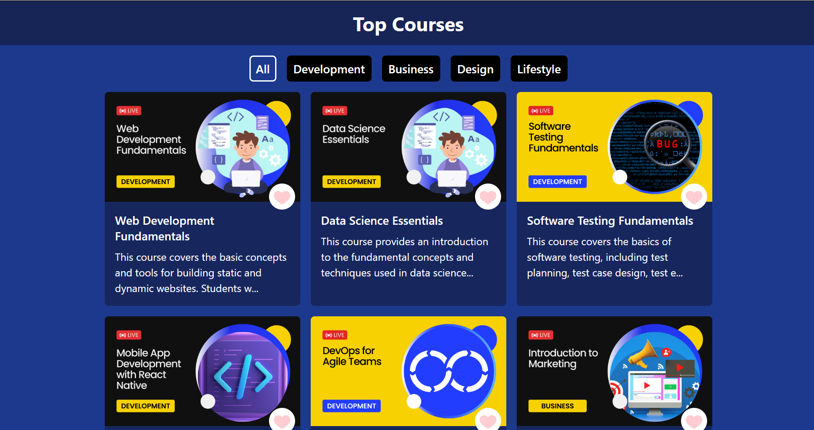

# 📚 Top Courses

A responsive React application that allows users to browse and filter courses by category. The project demonstrates dynamic filtering, reusable React components, and state management using React Hooks while providing a clean and responsive user interface.

---

## ✨ Features

- 📖 Browse courses from multiple categories
- 🎯 Filter courses by category
- ⚡ Dynamic UI updates using React Hooks
- 🔄 Reusable React components
- 📱 Fully responsive design
- 🎨 Clean and modern interface

---

## 🛠️ Tech Stack

- ⚛️ React
- 🟨 JavaScript (ES6+)
- 🎨 CSS3
- ⚡ Vite
- 🌿 Git & GitHub

---

## 🌐 Live Demo

🔗 https://react-top-courses-nine.vercel.app/

---

## 📂 Project Structure

```text
src/
├── assets/
├── components/
│   ├── Card.jsx
│   ├── Cards.jsx
│   ├── Filter.jsx
│   ├── Navbar.jsx
│   └── Spinner.jsx
├── data.jsx
├── App.jsx
├── App.css
├── index.css
└── main.jsx
```

---

## 📸 Project Screenshot



---

## 🚀 Getting Started

### Clone the repository

```bash
git clone https://github.com/Arsh173/react-top-courses.git
```

### Navigate to the project folder

```bash
cd react-top-courses
```

### Install dependencies

```bash
npm install
```

### Start the development server

```bash
npm run dev
```

---

## 📚 React Concepts Practiced

- Functional Components
- Props
- useState Hook
- Conditional Rendering
- Dynamic Filtering
- Event Handling
- Array Mapping
- Component Composition

---

## 🎯 Future Improvements

- 🔍 Search Courses
- ❤️ Add Favorites
- 🌙 Dark Mode
- 📄 Course Details Page
- 🔥 Backend Integration
- 💾 Save user preferences using Local Storage

---

## 👨‍💻 Author

**Arsh**

- GitHub: https://github.com/Arsh173
- LinkedIn: https://linkedin.com/in/arsh0786

---

## ⭐ Support

If you found this project helpful, consider giving it a ⭐ on GitHub!